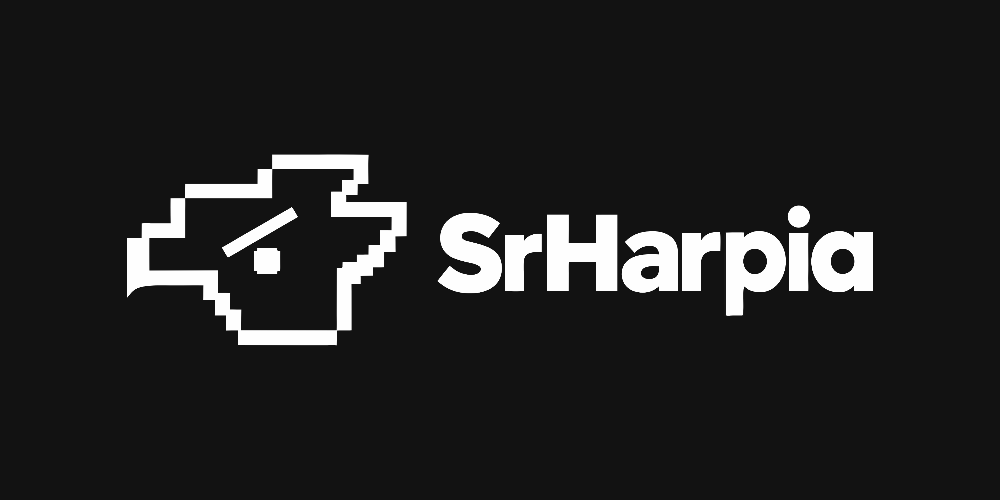

  <!-- Troque o caminho abaixo pelo banner quando você subir a imagem no repositório -->
  

# 🦅 SrHarpia

> Frontend de uma plataforma de observabilidade e APM (Application Performance Monitoring).

Projeto desenvolvido durante a **Residência Tecnológica do Porto Digital**.

---

## 📌 Sobre o projeto

O **SrHarpia** é o frontend de uma plataforma de observabilidade e APM, pensada para facilitar o monitoramento de aplicações e infraestrutura de forma simples e acessível.

## 🚧 Status

**Em fase de pesquisa e planejamento.**

Por enquanto, este repositório ainda não contém código. A equipe está pesquisando e definindo a melhor forma de construir o site, de acordo com as capacidades do time. Assim que essa etapa for concluída, o desenvolvimento começa por aqui.

